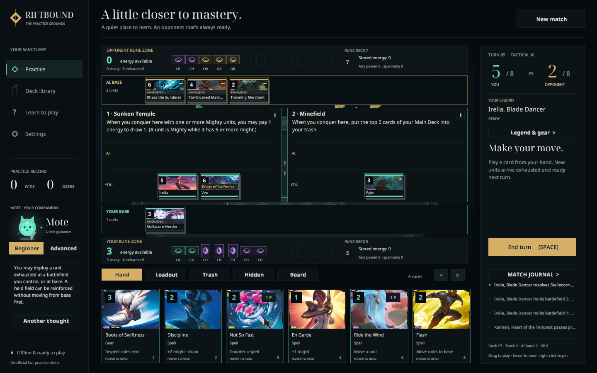

# Local Rift · The Practice Grounds

A native Rust client for exploring Riftbound against a simple AI. It includes a clear playmat over a quiet 3D backdrop, with art-faced unit cards and matching rune reserves, four tournament-derived presets, full card previews, and Mote, a small companion with Beginner and Advanced advice. A local Rust and JSON API supports custom automated opponents.



**This is an unofficial rules implementation under development, not yet identical to standard Riftbound.** The client models turns, resources, movement, scoring, showdowns, priority, and printed card, legend, equipment, and selected battlefield effects. Hover previews and inspectors show complete official text, followed by specific practice notes where needed. Coverage and remaining choice differences are recorded in [Implemented rules and limitations](docs/RULES.md); [Sources](docs/SOURCES.md) records the official references and errata. Only four battlefield choices are available, and simulated match results do not establish real deck strength.

## Run

Install a current stable Rust toolchain, then run from this directory:

```sh
./run.sh
```

The launcher builds the release client and selects the host graphics libraries when needed. On a normally configured desktop, `cargo run --release` also works. Use `./run.sh --small` for the smaller window.

The first build needs access to the Rust package registry. Card art is embedded into the executable at build time; normal play is offline and needs no account, API key, or server. A graphical desktop and an OpenGL-capable driver are required.

On Debian/Ubuntu, the usual native development packages are:

```sh
sudo apt-get install build-essential pkg-config libx11-dev libxi-dev libgl1-mesa-dev
```

Macroquad uses its native X11/OpenGL backend on Linux. XWayland can provide X11 compatibility on a Wayland desktop. A headless terminal alone cannot display the client.

On this development host, the client launches with the system graphics-library directory selected explicitly:

```sh
LD_LIBRARY_PATH=/usr/lib/x86_64-linux-gnu cargo run --release
```

That path is a workaround for this x86-64 Debian/Ubuntu host, not a portable requirement. Prefer your system's normal graphics configuration elsewhere. `cargo run --release -- --small` opens a 1152×720 window; the interface also scales when resized.

## Nix

The flake pins Nixpkgs and builds from `Cargo.lock`, including the embedded artwork and fonts. With flakes enabled:

```sh
nix run                       # Build and launch the game
nix run . -- --small           # Launch the smaller window
nix build                     # Create result/bin/local-rift, simulate, and rift-api
nix develop                   # Rust, Cargo, rustfmt, Clippy, rust-analyzer, and native libraries
```

Inside the development shell, use `cargo run --release` and `cargo test --locked` normally. The Linux package and shell supply the X11, input, keyboard, and OpenGL libraries that Miniquad loads at runtime. The packaged game does not depend on the host-library workaround in `run.sh`.

```sh
nix flake check               # Build, run the Rust tests, then simulate 256 games
nix run .#simulate -- --seeds 128
nix run .#api                  # Local JSONL interface for bots
nix fmt                       # Format flake.nix
```

Outputs are provided for x86-64 and ARM64 Linux, plus Apple Silicon macOS. Linux uses X11 or XWayland; launching the game still needs a graphical session. On non-NixOS Linux, matching the host GPU drivers may require [nixGL](https://github.com/nix-community/nixGL). macOS uses the system graphics frameworks. Only x86-64 Linux has been tested here.

`flake.lock` pins the toolchain and system dependencies; update them intentionally with `nix flake update`. Git-based flakes include tracked files, so remember to add new source files and assets to Git when extending the game. Build outputs such as `target/` and `result` are excluded from the package source.

## First match

1. Choose a deck for yourself and another for the AI in **Practice** or **Deck library**. All four presets can be used on either side.
2. Choose the battlefields, who starts, and **Relaxed** or **Tactical** difficulty, then **Start practice**.
3. Select up to two opening cards to replace, then begin.
4. Deploy units at base or a controlled battlefield. Move ready units, individually or as a group, to contest points.
5. During a showdown or spell chain, use your legal responses or **Pass priority**. In an open turn, the same control becomes **End turn**.
6. Hover over a card or unit to read its full text; right-click to pin the inspector. Mote can explain a current decision or offer another thought.

Both players use the same rune layout: upright runes are ready, sideways runes are exhausted, and the rune deck shows how many remain to be channeled. Use your rune controls to exhaust or recycle a chosen domain before a play, or let payment activate runes automatically. Stored energy, colored power, flexible power, and spell-only power are shown separately. Battlefield panels explain their effects, and equipped gear is visible on its unit with hover access to the card text.

| Control | Action |
|---|---|
| Click one of your rune cards | Choose to exhaust it for energy or recycle it for power |
| Click a unit's equipment label | Inspect that attached gear and its complete text |
| Battlefield **i** button | Pin the location's full effect and scoring reminder |
| Left-click a hand card | Select it; use its play/deploy button, or click an eligible target |
| Drag a hand card | Drop on a highlighted destination or target; plays needing more choices remain selected for confirmation |
| Left-click a friendly unit | Select its movement controls |
| Drag a friendly unit or selected group | Move to a legal highlighted battlefield or your base |
| Click a battlefield with a unit selected | Move there if legal |
| **Group all … ready here** / Shift-click friendly units | Group ready units for one move to a common destination |
| Move / return buttons | Move the selected unit or group |
| **Pass priority** / `Space` | Pass during a chain or showdown; end the turn when no window is open |
| Decision buttons and card choices | Resolve Predict, optional payments, discard, revealed cards, trash plays, and unit choices |
| Combat damage controls | Review or edit the target order before simultaneous combat damage |
| Repeat target toggle | Choose separate targets for the repeated spell effect |
| **Board** / **Loadout** / **Trash** | Browse all units, inspect public loadouts and trash for either player, and use your eligible cards |
| Right-click a card or unit | Open its inspector and official rules text |
| Hover over a card or unit | Read its complete preview; scroll inside a long preview or inspector |
| `1`–`9` | Select the corresponding card in your hand |
| `H` | Open the guide from Practice |
| `Esc` | Cancel selection, close an overlay, or return to Practice |
| On-screen arrows | Browse decks, scroll the hand/list, or adjust the board view |
| Mouse wheel over the deck list | Scroll the selected preset's cards |

An invalid drop or a cancelled drag spends no resources. Click controls remain available alongside dragging.

Choose Mote's **Beginner** or **Advanced** level in the sidebar, or turn advice off in Settings. Mote considers your hand, the public board, and information effects explicitly let you see; it does not peek at private opponent cards. Advice is optional and never interrupts an action.

The client saves completed wins/losses and coach, advice level, animation, and difficulty preferences to `$XDG_DATA_HOME/local-rift/preferences.txt`, or `~/.local/share/local-rift/preferences.txt` when `XDG_DATA_HOME` is unset. **New match → Choose matchup** returns to setup and re-enables deck selection. There is no resumable match-save format.

## Included presets

| Deck | Real archetype reference | Published source |
|---|---|---|
| Irelia / Blade Dance | Movement, choosing friendly units, and conquest | Xeno, Los Angeles runner-up, September 2026 |
| Master Yi / Wuju | Buffs and efficient combat | SWAGALISK, Los Angeles sixth place, September 2026 |
| Kennen / Tempest | Repeated actions, tokens, and resource loops | DSG AwesumRosum, Los Angeles thirteenth place, September 2026 |
| Kai'Sa / Void Control | Spell resources, removal, and finishers | Sinzari, Vancouver fifteenth place, May 2026; historical list |

The three Los Angeles lists are recent competitive examples as of **October 24, 2026**. Kai'Sa is an older competitive archetype included for variety. These are dated source lists, not an assertion about the newly released Radiance metagame. The full 40-card main lists are preserved, and all 69 included cards have executable printed-effect mappings. All four legend powers, persistent equipment, Hidden, Flow, Repeat, Accelerate, and Empower are implemented. The engine now exposes trigger order, on-play targets, death replacements, and rune activation as choices. Coverage and remaining interface limits are described in [RULES.md](docs/RULES.md); this is still an unofficial implementation under development.

Counts, card IDs, original rune splits, and source URLs are recorded in [`assets/data/decks.json`](assets/data/decks.json). The [official tournament sources](docs/SOURCES.md) explain provenance and historical legality.

## Automated opponents

Run `cargo run --locked --bin rift-api` or `nix run .#api` for a local JSONL process: send one JSON request per line on standard input and read one response per line from standard output. No server or API key is required. The Rust facade is `local_rift::api::Session`.

The API supports seeded setup, both players' mulligans, private player observations, action validation, explicit targets and optional costs, group movement, combat assignments, and stepping the built-in AI. Every mutation checks a revision and commits only after validation. Suggested actions are a convenience subset; custom bots can submit structured actions directly. See [the protocol and example bot](docs/API.md).

This process is a trusted match coordinator that can request either player's view. Keep opponent bots separated from that coordinator if hidden-information isolation matters.

## Development and verification

The implementation uses **Rust + Macroquad**, with a pure Rust rules layer separated from rendering.

| File | Responsibility |
|---|---|
| `src/main.rs` | Screens, input, selection, match flow, and preferences |
| `src/game.rs` | Deterministic game state, legal actions, priority, effect execution, and AI |
| `src/cards.rs` | Card facts, official text, and preset compositions |
| `src/battlefields.rs` | Four official battlefield choices and their triggers or damage modifier |
| `src/legends.rs` | Four legend powers, optional trigger costs, and combat bonuses |
| `src/hidden.rs` | Facedown slots, Hidden timing, target restrictions, and visibility |
| `src/gear.rs` | Persistent gear, attachment abilities, resource generation, and death prevention |
| `src/rules.rs` | Declarative official effect and keyword reference; metadata alone does not imply engine support |
| `src/companion.rs` | Mote's advice and procedural character drawing |
| `src/scene.rs` | Tabletop backdrop, unit positions, and picking regions |
| `src/ui.rs` | Typography, controls, and card presentation |
| `src/smoke.rs` | Native UI interaction checks |
| `src/bin/simulate.rs` | Deterministic all-matchup simulation checks |
| `src/api.rs` / `src/bin/api.rs` | Player views, validated Rust interface, and local JSONL bot protocol |
| `tests/conformance.rs` | Independent examples from official rules and errata, plus catalog consistency |
| `build.rs` | Embeds local card art into the executable |
| `assets/data/decks.json` | Data provenance; not a runtime import format |

Run checks without a graphics window:

```sh
cargo test --locked
cargo fmt --all --check
cargo clippy --locked --all-targets -- -D warnings
cargo run --locked --bin simulate
```

The simulator runs **1,024 matches** by default: all 16 ordered deck pairings, both AI levels, and 32 seeds. Starting players alternate across seeds, so each pairing and AI level includes 16 games from each starting position. It checks card/rune conservation, energy accounting, unit validity, and winner consistency after every action, and fails on an illegal action or stalled game. Example options:

```sh
cargo run --bin simulate -- --seeds 128 --seed 1 --max-steps 5000
```

Run the native UI smoke check on a graphical desktop, isolating its test preferences:

```sh
XDG_DATA_HOME=/tmp/local-rift-ui-smoke-data ./run.sh --ui-smoke
```

It clicks through setup, mulligan, deployment, board selection, group movement, priority, the inspector, advice/settings, restarting with a different deck, legend and gear resource abilities, the trash browser, empty-card choices, victory replay, on-play targets, separate Repeat targets, manual combat target order, journal navigation, and the second-player opening. It also exercises drag/drop and cancellation, multi-target staging, long-text scrolling, rune activation, attached gear previews, battlefield inspection, and opponent-trash browsing. The `--small` option can also exercise scaled coordinates. Apply the graphics-library workaround above if this host requires it.

Verified on October 24, 2026: **183 automated Rust tests, 4,096 simulated games, all 16 matchups through the JSON bot process, and 106-step native interaction checks at 1440×900 and 1152×720.** Formatting and Clippy with warnings denied pass. The Nix package builds and passes its tests and simulation check; its packaged client and bot API also run successfully on x86-64 Linux. The simulation covers both starting positions for all pairings and both AI levels.

These tests verify implemented behavior and application consistency; they do not certify official rules compliance.

## Artwork and attribution

The 69 bundled card thumbnails come from Riot's official card gallery. Riftbound, its characters, card names, and artwork are Riot Games property. This personal offline prototype is unaffiliated with Riot Games. The tabletop scenery and Mote are drawn procedurally. The two battlefield panels show the selected official fields and their full effect text. See [SOURCES.md](docs/SOURCES.md) for attribution and exact source URLs.
