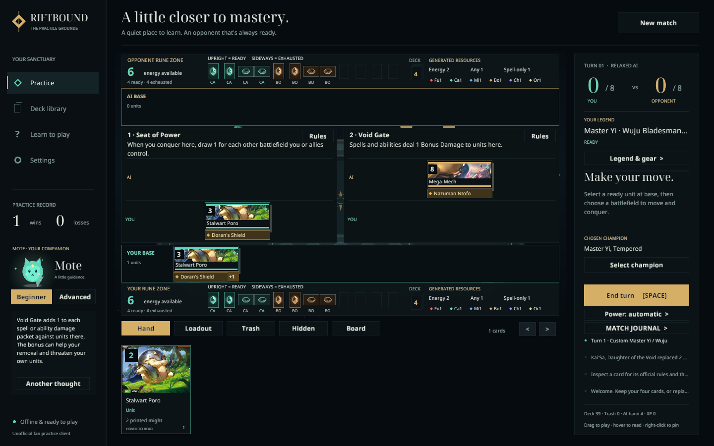

# Local Rift · The Practice Grounds

A native Rust client for practicing Riftbound against three levels of AI. It includes a clear playmat over a quiet 3D backdrop, with art-faced unit cards, matching rune reserves and side victory-point tracks, seven tournament-derived presets, eleven playable legends, a custom deck editor, full card previews, and Mote, a small companion with Beginner and Advanced advice. A local Rust and JSON API supports custom automated opponents.



**This is an unofficial rules implementation under development, not yet identical to standard Riftbound.** The client models turns, resources, movement, scoring, showdowns, priority, and printed card, legend, equipment, and selected battlefield effects. Hover previews and inspectors show complete official text, followed by specific practice notes where needed. Coverage and remaining choice differences are recorded in [Implemented rules and limitations](docs/RULES.md); [Sources](docs/SOURCES.md) records the official references and errata. Seventeen battlefield choices are available, and simulated match results do not establish real deck strength.

## Run

Install a current stable Rust toolchain, then run from this directory:

```sh
./run.sh
```

The launcher builds the release client and selects the host graphics libraries when needed. On a normally configured desktop, `cargo run --release` also works. Use `./run.sh --small` for the smaller window.

The first build needs access to the Rust package registry. Card art is embedded into the executable at build time; normal play is offline and needs no account, API key, or server. A graphical desktop and an OpenGL-capable driver are required.

On Debian/Ubuntu, the usual native development packages are:

```sh
sudo apt-get install build-essential pkg-config libx11-dev libxi-dev libgl1-mesa-dev
```

Macroquad uses its native X11/OpenGL backend on Linux. XWayland can provide X11 compatibility on a Wayland desktop. A headless terminal alone cannot display the client.

On this development host, the client launches with the system graphics-library directory selected explicitly:

```sh
LD_LIBRARY_PATH=/usr/lib/x86_64-linux-gnu cargo run --release
```

That path is a workaround for this x86-64 Debian/Ubuntu host, not a portable requirement. Prefer your system's normal graphics configuration elsewhere. `cargo run --release -- --small` opens a 1152×720 window; the interface also scales when resized.

## Nix

The flake pins Nixpkgs and builds from `Cargo.lock`, including the embedded artwork and fonts. With flakes enabled:

```sh
nix run                       # Build and launch the game
nix run . -- --small           # Launch the smaller window
nix build                     # Create result/bin/local-rift, simulate, and rift-api
nix develop                   # Rust, Cargo, nextest, rustfmt, Clippy, rust-analyzer, native libraries
```

Inside the development shell, use `cargo run --release` and `cargo test --locked` normally. The Linux package and shell supply the X11, input, keyboard, and OpenGL libraries that Miniquad loads at runtime. The packaged game does not depend on the host-library workaround in `run.sh`.

```sh
nix flake check               # Build, test, and simulate every preset pairing
nix run .#simulate -- --seeds 128
nix run .#api                  # Local JSONL interface for bots
nix fmt                       # Format flake.nix
```

Outputs are provided for x86-64 and ARM64 Linux, plus Apple Silicon macOS. Linux uses X11 or XWayland; launching the game still needs a graphical session. On non-NixOS Linux, matching the host GPU drivers may require [nixGL](https://github.com/nix-community/nixGL). macOS uses the system graphics frameworks. Only x86-64 Linux has been tested here.

`flake.lock` pins the toolchain and system dependencies; update them intentionally with `nix flake update`. Git-based flakes include tracked files, so remember to add new source files and assets to Git when extending the game. Build outputs such as `target/` and `result` are excluded from the package source.

## First match

1. Choose a deck for yourself and another for the AI in **Practice** or **Deck library**. All seven presets can be used on either side. The legend picker can create editable training lists for eleven legends, and the deck editor saves a custom list for you and one for the AI.
2. Choose the battlefields, who starts, and **Relaxed**, **Tactical**, or **Strategic** difficulty, then **Start practice**.
3. Select up to two opening cards to replace, then begin.
4. Play units at base or a controlled battlefield. Move ready units, individually or as a group, to contest points.
5. During a showdown or spell chain, use your legal responses or **Pass priority**. In an open turn, the same control becomes **End turn**.
6. Hover over a card or unit to read its full text; right-click to pin the inspector. Mote can explain a current decision or offer another thought.

**Practice format** opens the date and deck checks for either single games or best-of-three matches. New installations use **Standard · today**, resolved from your computer's local date when the match starts. The accepted date stays fixed through sideboarding and every game of that match. Setup shows the last source-review date; this is an offline rules bundle, not a live metagame service. Its scope is global Standard 1v1, not regional release schedules.

Choose **Historical snapshot** to practice the original dated tournament lists under the bundled October 24 catalog, or use the announced-date button to preview scheduled restrictions. The panel checks both players, names banned cards and battlefields, and warns about upcoming restrictions. Best-of-three checks include the complete sideboard and all registered fields. Rejected starts preserve an existing match; no cards are silently substituted. The format remains visible during play and between games. For repeatable launches, `--format today`, `--format snapshot`, or `--format YYYY-MM-DD` selects the format at launch. Existing native smoke scenarios explicitly use historical practice; `--ui-smoke-format` exercises the date controls and rejection paths.

Relaxed uses straightforward plays. Tactical weighs combat and resources. Strategic compares bounded sequences of possible plays and their public board outcomes. It samples unknown draws from cards legal for the public legend identity; it cannot read the opponent’s hidden hand, deck list, facedown identities, or future deck order. Its short search assumes no further discretionary responses while resolving a candidate, so it remains a practice opponent rather than a tournament-strength benchmark.

The opponent thinks in the background. You can inspect cards, open Learn to play or Settings, and choose a new match while a calculation is running. A completed move waits while an inspection or menu pauses play. Starting a new match discards any result from the old one. If a calculation fails, the match stays unchanged and an explicit **Retry opponent** control lets you try again.

Both players use the same rune layout: upright runes are ready, sideways runes are exhausted, and the rune deck shows how many remain to be channeled. Use your rune controls to exhaust or recycle a chosen domain before a play, or let payment activate runes automatically. Enable **Power: choose sources** to choose exactly which generated power and runes pay for each action. Generated energy, colored power, flexible power, and spell-only power are shown separately. Battlefield effects remain visible on the mat, with a **Rules** button for the full explanation. A gold strip beneath each equipped unit shows its gear. Click a gear name to inspect it, or the **N gear** count to open all attachments. Sparse unit rows expand to make names and artwork easier to read. Board thumbnails crop the artwork proportionally instead of stretching it; hover for the full card.

Sand Soldier, Sprite, Bird, Tentacle, Mech, Recruit and Gold tokens have their own
official artwork on the board and in previews. Right-click a token to keep its
details open: current Might, damage, keywords, attached equipment and its own
rules. Dragging a unit token keeps that token's artwork. A token that leaves the
board is identified as departed in its inspector.

Deploy gear has its own illustrated row at each battlefield. Click the field’s gear count to open those exact copies in Loadout; attached equipment remains visible beneath its bearer. Gear can occupy a battlefield without controlling or contesting it. Command: Attack offers separate Move and Gear-draw modes, and each Repeat keeps its own choices. Optional paid gear triggers show their source and targets before payment. **Undo payment** returns to that choice; **Decline** skips the optional trigger. Mote explains each step at your selected advice level.

A unit’s **Might** and **combat damage** are shown separately when they differ. Ezreal, Dashing keeps his Might for lethal damage and his printed ability while contributing zero combat damage. Orianna, Exquisite deals combat damage only while friendly gear shares her location; gear attached to another friendly unit there counts. Her inspector shows whether that requirement is met. Stun is shown as its own reason for contributing zero. Hover or pin the unit to read the complete explanation. Rengar, Pouncing’s destination controls retain an attacked battlefield while you remain its attacking player, even after your last unit leaves.

Victory points climb the board’s outer edges: your teal track is on the left, and the opponent’s gold track is on the right. Filled steps show points earned; the diamond marks the current total. Both tracks share the same scale from zero to eight. The decorative scenery is clipped to the board so it stays clear of the companion and controls.

Abilities that recycle trash show a separate cost tray, so those cards are not confused with effect targets. Resource conversions have an amount control and can use another resource ability before finishing. **Generate resources** keeps the chosen play and its calculated cost fixed while you pay. A card being played appears as pending and leaves its original zone. Before finalization, **Undo payment** restores the staged payment boundary even when a positive resource cost is affordable. **Decline** abandons that unfinished positive cost and restores resources generated for the same pending attempt. A zero-cost mandatory finalization cannot be refused through this control. Resource instructions already under way must finish before either option is available.

Gear with **Empower** has a separate ability button and a visible Empowered state. Its second ability may spend that state as a Disempower cost. Costs and use restrictions appear before confirmation; ordinary Empower takes effect after responses. The same controls handle gear with multiple printed abilities.

Empowered units have a visible status marker. Their inspector shows current Might and keywords, plus active and inactive conditional effects with their sources. Ability controls show the current payable cost, including rune discounts. Apprentice Mage's Predict2 lets you keep or recycle each card and order the kept cards before confirming. The legend picker includes editable training lists for Ambessa, Rengar and Ezreal. Use its page controls to browse all eleven legends. Rengar asks you to choose a unit after each unit play; Ezreal’s legend panel shows progress toward its two enemy choices and enables the draw ability when its prerequisite is met.

XP costs are shown separately from Energy and Power. Crowd Favorite and Enthralling Protector spend2XP before their self-Buff can be responded to. Honeyfruit shows both of its resource abilities at Level6, including the exact Energy/Any Power output. Shepherd's Heirloom gains1XP when played and spends1XP to Equip; its gold attachment strip then shows the bearer’s gear as usual. Fixed payments preserve the declared XP cost, and failed-attempt rollback restores XP and generated resources together.

When an effect lets you look through your deck, choose a highlighted card or **Recycle all**, then confirm. The tray identifies each physical copy and explains why other cards cannot be selected. Only you see your private look; Aurora’s reveals are public and can be paged through. Wild Claw offers its separate Empower after the chosen unit or gear enters, with time for responses.

Open **Trash → Banish** to inspect banished cards. The owner button switches between your cards and the opponent’s. Clicking a banished card opens its full text. Click **Banish** again to return to trash.

Gear-targeting abilities open the Loadout, highlight legal equipment, and retain your chosen target when switching players. Printed Energy limits appear beside the confirmation controls; optional abilities have a separate decline button.

Temporary units have a visible marker and a hover explanation of their expiry. Sprite previews show the token’s own identity. Petal Pixie shows its live bonus, and ordered target guidance explains which unit to choose next. Mixed unit/gear spells keep their draft when switching to Loadout.

The battlefield picker previews each location's art and full rules before selection. **Turn effects** shows delayed grants and their expiry. **Play choices** lets you select independent Repeat costs and targets, while **Review costs** handles Energy-versus-Power discounts and their order. The same choices are available to automated opponents through the API. Firestorm selects a named battlefield, even when it is empty; each Repeat execution can select a different field. Those field choices remain visible while players can respond. Area damage follows the selected area, and the unit inspector explains bonuses such as Taric’s nearby Shield or Wielder of Water fighting alone.

| Control | Action |
|---|---|
| **Power: choose sources** | Review each power payment; adjust sources, use the suggestion, or close the editor before submitting |
| Click one of your rune cards | Choose to exhaust it for energy or recycle it for power |
| Click a unit's gold equipment strip | Inspect the named gear; click **N gear** to open all attachments |
| Battlefield **Rules** button | Pin the location's full effect and scoring reminder |
| Left-click a hand card | Select it; use its play/deploy button, or click an eligible target |
| Drag a hand card | Drop on a highlighted destination or target; plays needing more choices remain selected for confirmation |
| Left-click a friendly unit | Select its movement controls; use **Abilities** for printed activations |
| Conversion controls | Choose how much energy or power to convert; use another resource ability and return to the same payment |
| Unit or gear ability controls | Choose an ability and targets, then confirm its cost; cancelling an unsubmitted activation spends nothing |
| Drag a friendly unit or selected group | Move to a legal highlighted battlefield or your base |
| Click a battlefield with a unit selected | Move there if legal |
| Click or drop a battlefield-targeting spell on a field | Choose that physical field; use the execution tabs to set each Repeat target |
| **Group all … ready here** / Shift-click friendly units | Group ready units for one move to a common destination |
| Move / return buttons | Move the selected unit or group |
| **Pass priority** / `Space` | Pass during a chain or showdown; end the turn when no window is open |
| Decision buttons and card choices | Resolve Predict, optional payments, discard, revealed cards, trash plays, and unit choices |
| Combat damage controls | Reorder targets or use **Exact amounts** to assign damage to each unit before simultaneous combat damage |
| Repeat target toggle | Choose separate targets for the repeated spell effect |
| **Board** / **Loadout** / **Trash** | Browse all units, inspect public loadouts and trash for either player, and use your eligible cards |
| Right-click a card or unit | Open its inspector and official rules text |
| Hover over a card or unit | Read its complete preview; scroll inside a long preview or inspector |
| `1`–`9` | Select the corresponding card in your hand |
| `H` | Open the guide from Practice |
| `Esc` | Cancel selection, close an overlay, or return to Practice |
| On-screen arrows | Browse decks, scroll the hand/list, or adjust the board view |
| Mouse wheel over the deck list | Scroll the selected preset's cards |

An invalid drop or a cancelled drag spends no resources. Click controls remain available alongside dragging. Closing the source editor does not undo a payment already started. Choosing zero for a resource conversion finishes it but keeps the exhaustion cost already paid; a failed payment attempt can be rolled back with its separate rollback control.

Choose Mote's **Beginner** or **Advanced** level in the sidebar, or turn advice off in Settings. Mote considers your hand, the public board, and information effects explicitly let you see; it does not peek at private opponent cards. Advice is optional and never interrupts an action.

The client saves completed wins/losses and coach, advice level, animation, and difficulty preferences to `$XDG_DATA_HOME/local-rift/preferences.txt`, or `~/.local/share/local-rift/preferences.txt` when `XDG_DATA_HOME` is unset. **New match → Choose matchup** returns to setup and re-enables deck selection. Custom lists are stored beside those preferences as `custom-you.json` and `custom-ai.json`. The editor validates before saving, and saved lists can also be passed to the example bot. There is no resumable match-save format.

The [Arito validation](docs/validation/irelia_arito.json) covers the exact
Arito Convergence IV preset and Edge of Night: **1,598 Rust tests**, **269 source
checks**, **72 exact-list games**, **24 bot API games**, and **eight native UI
runs** passed. Sideboard and battlefield tabs expose the registered choices.
The native **Best of three** mode now uses that complete registration for match
practice, including legal swaps between games.

Registered best-of-three matches are available in the **native app, Rust engine
and bot API**, including legal sideboarding, private battlefield selection and
match scores. In Practice, choose **Best of three**, then select Xeno Irelia,
Arito Irelia, Master Yi, Kennen, Rengar, or Sonecon Riven for either seat and follow the setup steps. Mote explains match
rules or planning at your chosen advice level. See
[match practice](docs/MATCH_SERIES.md) for instructions and current limits.
The [match validation](docs/validation/match_series.json) passed **1,609 Rust
tests**, **269 source checks**, **36 engine matches (91 games)** and **12 release
bot API matches (29 games)**. The subsequent native interface is documented in
[its validation record](docs/validation/native_match_series.json): **1,612 Rust
tests**, **269 source checks**, **six controller matches (14 games)** and **20
release UI runs** passed. The match UI runs cover three AI levels and two window
sizes; twelve runs each play a complete match. Card coverage is unchanged.

Tactical and Strategic match opponents now remember revealed cards and consider
legal sideboard swaps while preserving Irelia's core engine. **Mote: review my
sideboard** offers an optional suggestion without moving your cards. The bot API
exposes the same planner and scouting history. The [match-AI validation
record](docs/validation/match_ai.json) includes a fresh 32-pair comparison: the
adaptive policy won 12 matches and the unchanged-deck baseline won 9. This limited
simulation does not establish tournament or expert strength. Card coverage and
the remaining rules limitations are unchanged.

Unyielding Spirit and Repulse are available in the card library and deck editor.
Unyielding Spirit prevents spell and ability damage for both players for the turn;
it leaves unit-dealt damage and independent instructions intact. Repulse first
chooses your battlefield unit, then an eligible enemy spell or ability. Its
choices account for every Repeat execution. Both cards include complete previews
and optional advice. See the [reaction-card validation](docs/validation/master_yi_reactions.json)
for the source, rules, game, UI and package checks. The complete Master Yi
registration is now available for best-of-three practice, with its exact ten-card
sideboard and three battlefields. Its main deck is unchanged. The
[registration validation](docs/validation/master_yi_registration.json) records
1,819 Rust tests, 48 native and packaged API matches (119 games each), and six
packaged interface runs. Every packaged API trace matches the native build.
Mote and the stronger AI levels consider sideboard options using revealed cards;
these heuristics do not establish expert-level strategy.

Alpha Strike, Brutalizer and Hand Hammer are available in the card library and deck editor.
Alpha Strike asks you to choose a friendly source and enemy battlefield units,
then divide damage when it resolves. Its XP rewards resolve separately.
Brutalizer's temporary attachment bonus and Hand Hammer's two-unit condition
appear in the unit inspector, alongside the visible equipment strip. These
three additions passed 1,815 Rust tests, 282 source checks, 1,176 preset simulations
and installed-client checks. All 432 installed API game traces match the native
build. See the [release validation](docs/validation/alpha_equipment.json) and
[Alpha Strike rules audit](docs/ALPHA_STRIKE_AUDIT.md).

Hidden Blade is available for custom practice, including Hidden play, death
replacement choices, complete card inspection and optional Mote advice. Invalid
targets stop its instructions; a valid target saved by a death replacement still
lets its controller draw two. Successful drag-and-drop now clears an earlier
invalid-drop message.

The engine and API also record physical damage sources and supported Kill
credits. Resource abilities reject an unrepresentable total before consuming
their source. These changes passed 1,842 Rust tests and 284 source checks;
84 packaged card-test games and 48 registered matches reproduce native traces.
See [the validation](docs/validation/hidden_blade.json) and the remaining
attribution scope in [the rules audit](docs/RULES_AUDIT.md).

Deathgrip is available in custom practice decks. Choose two different friendly
units before responses; an actual death transfers the first unit’s current Might
for the turn, and drawing a card is a separate instruction. Death replacements
finish before the draw. Beginner and Advanced Mote advice explain these choices.
Its [validation record](docs/validation/deathgrip.json) includes 1,852 Rust tests,
286 source checks, and matching native/packaged traces across 84 card-test games
and 48 registered matches.

Guards! is available for custom practice. It creates a Sand Soldier, then offers
a separate optional Order Power payment to ready that exact token. Opponents get
a response opportunity after payment. Its Hidden and Repeat behavior follows
the official erratum; Mote explains the choices at both advice levels. This adds
a card to the supported pool, without changing the seven tournament recipes.
The [combined validation record](docs/validation/guards_tokens.json) distinguishes
the accepted Guards rules from the final token-art package checks.

## Included presets

| Deck | Real archetype reference | Published source |
|---|---|---|
| Irelia / Blade Dance | Movement, choosing friendly units, and conquest | Xeno, Los Angeles runner-up, September 2026 |
| Master Yi / Wuju | Buffs and efficient combat | SWAGALISK, Los Angeles sixth place, September 2026 |
| Kennen / Tempest | Repeated actions, tokens, and resource loops | DSG AwesumRosum, Los Angeles thirteenth place, September 2026 |
| Kai'Sa / Void Control | Spell resources, removal, and finishers | Sinzari, Vancouver fifteenth place, May 2026; historical list |
| Rengar / Pridestalker | Temporary Might, unit sequencing, and movement | DSG Prismaticism, Los Angeles winner, September 2026 |
| Irelia / Arito Convergence IV | Orianna, equipment, ready effects, and movement | Arito, Convergence IV runner-up, October 31, 2026 |
| Riven / Sonecon Stuttgart | Ready entrants, equipment, movement, and Baron Pit | Sonecon, European Regional Championship runner-up, November 2026 |

The four Los Angeles lists were rechecked against Riot’s published source on **October 26, 2026**. Kai'Sa is an older competitive archetype included for variety. These are dated source lists. The Riven preset separately reproduces Sonecon’s exact Stuttgart main deck, sideboard, runes and three fields from Riot’s November 11 article, rechecked on November 12. Baron can add a third battlefield during play; the board, movement choices, scoring and bot API include it. The full 40-card main lists are preserved. All 446 supported main-deck cards have executable printed-effect mappings. Arito’s exact 40-card list was independently checked against its original organizer deck page on November 11, including two Edge of Night, three Orianna and one Gust Monk. All eleven registered legend powers, persistent equipment, Hidden, Flow, Repeat, Accelerate, and Empower are implemented. The additional unit and gear activations include explicit targets, trash-recycling, sacrifice and Disempower costs, response windows, and resource conversions during permitted payments. The engine exposes trigger order, on-play targets, death replacements, and rune activation as choices. Coverage and remaining interface limits are described in [RULES.md](docs/RULES.md); this is still an unofficial implementation under development.

Use **Prev** and **Next** in the deck library to browse all seven presets. Each preset can be selected for either seat or copied into the editor. The complete Xeno Irelia, Arito Irelia, Kennen, Rengar, and Sonecon Riven registrations have **Main deck**, **Sideboard**, and **Battlefields** tabs. Inspect all ten sideboard cards and all three battlefield rules; after selecting the preset for a seat, choose its battlefield there. Choose **Best of three** in Practice and **Next registered deck** for either seat to practice these complete lists with sideboarding. Other presets and saved custom lists remain available for single-game practice.

Counts, card IDs, original rune splits, and source URLs are recorded in [`assets/data/decks.json`](assets/data/decks.json). The [official tournament sources](docs/SOURCES.md) explain provenance and historical legality.

The legend picker adds **Darius / Hand of Noxus**, **Viktor / Herald of the Arcane**, **Lux / Lady of Luminosity, Starter**, and **Ambessa / Matriarch of War**, **Rengar / Pridestalker**, and **Ezreal / Prodigal Explorer** alongside the original four. It shows each legend’s official portrait and full rules. Create an editable 40-card training list, adjust it in the editor, and save it for either seat. These six lists are authored practice starting points, not sourced meta decks. Darius practices Legion sequencing, Viktor develops Recruit boards, Lux rewards spells with a printed Energy cost of five or more, Ambessa practices Empowering objects and readying units, Rengar turns unit plays into temporary Might, and Ezreal rewards choosing enemy units or gear with spells and unit abilities. Thrill of the Hunt and Arcane Shift are available. These authored training recipes stay separate from the tournament presets, including the sourced Rengar winner’s list.

Legend identity is independent of preset choice and chosen-champion variant. Existing saved decks keep their numeric identities; invalid saved files now produce a visible load message without being overwritten.

The [full card inventory](docs/CARD_COVERAGE.md) accounts for 1,079 legal Standard identities, rechecked on October 26, 2026. Current support maps 468 identities, including 435 main-deck cards, ten legends, seventeen battlefields, and six runes; 611 remain unavailable. The reproducible importer preserves official printings, bans, and errata without registering unsupported cards as playable. Its [source review](docs/CATALOG_REVIEW.md) records 139 field corrections or confirmations, backed by archived official artwork and rules. All 37 original issue groups are retained alongside seventeen later artwork-confirmed discrepancies. Original source values remain available alongside the reviewed facts. Complete [alternate-printing reviews](docs/VARIANT_REVIEW.md) now cover 31 playable identities and all 94 of their gallery printings, replacing the previous compatibility exceptions. Kennen’s missing Ionia tag is corrected in gameplay and the bot API. Another 93 identities have alternate-printing differences still awaiting review; those identities remain unavailable. Unresolved gameplay facts or variant differences prevent admission. Source corrections alone do not register playable cards. The latest Irelia admissions add [Decree of Focus](assets/data/card_admissions/irelia_focus/README.md), [Find Your Center and Hush](assets/data/card_admissions/irelia_next/README.md), [Ravenbloom Prefect](assets/data/card_admissions/irelia_raven/README.md), [Hunker Down](assets/data/card_admissions/irelia_hunker/README.md), [Battle Preparations](assets/data/card_admissions/irelia_preparations/README.md), [Siren’s Song](assets/data/card_admissions/irelia_siren/README.md), [Back Off](assets/data/card_admissions/irelia_backoff/README.md), [Reckless Innovator](assets/data/card_admissions/irelia_innovator/README.md), [Orianna, Exquisite](assets/data/card_admissions/irelia_orianna/README.md), [Gust Monk](assets/data/card_admissions/irelia_gust/README.md), and [Edge of Night](assets/data/card_admissions/irelia_edge/README.md). The preceding admission added Irresistible Faefolk; Kinkou Initiate; Nidalee, Cat Form; Pyke, Dockside Butcher; and six battlefields. Their [source evidence](assets/data/card_admissions/c28/README.md) preserves all eleven original faces, both Pyke printings, and the current Emperor’s Dais and Targon’s Peak errata. Individual runes retain their identity through exhaustion and readying; recycled runes leave play. Battlefield choices expose optional targets, resource payments and costs separately. The [Rengar preset evidence](assets/data/preset_admissions/rengar_2026_09/README.md) records the exact winning list and unchanged training recipes. The preceding admission added Yasuo, Remorseful; Graves, Blasting Through; Lucian, Gunslinger; and Armored Tusker. Their [source evidence](assets/data/card_admissions/c27/README.md) preserves all six official faces. Their abilities read current Might, Assault, or Shield when they resolve; Graves damages all enemies at his current location without choosing targets. The inspector shows these live values, and Mote explains the distinction from combat damage. The preceding admission added Rengar, Pouncing and Ezreal, Dashing. Their [source evidence](assets/data/card_admissions/c26/README.md) preserves all four official faces. Rengar can enter a battlefield where you are still the attacking player; Ezreal uses his current Might for his Attack/Defend ability while contributing no combat damage. The preceding admission added eight Deploy gear cards, Overloaded Traveler and Command: Attack, with independent battlefield gear, optional paid triggers and explicit Move or private Gear-draw modes. Their [source evidence](assets/data/card_admissions/c24/README.md) preserves all ten complete official faces and their printing cohorts. The preceding gameplay admission added Gemcraft Seer, Forecaster and Jeweled Colossus, with source-attributed Vision grants, independent entry triggers and actual token identity. Their [source evidence](assets/data/card_admissions/c22/README.md) preserves all three complete original faces. The preceding gameplay admission added Ornn, Blacksmith; Clairvoyance; and Scryer's Bloom, with private Gear selection and ordered Predict, Draw and XP instructions. Their [source evidence](assets/data/card_admissions/c21/README.md) preserves all four original gallery faces, including both Ornn printings. The preceding admission added Double Trouble, Fate Weaver, Trifarian Captain, Apprentice Smith, Raving Witness and Pakaa Protector, with private inspected draws and public Move-triggered reveals. Their [source evidence](assets/data/card_admissions/c20/README.md) preserves all six complete faces and separately records two printed-tag corrections. The preceding admission added Baited Hook, Dazzling Aurora, Reinforce and Wild Claw, with private deck selection, public reveals, precise cost reductions and linked Empower. Their [source evidence](assets/data/card_admissions/c19/README.md) keeps original faces and current errata separate. The preceding admission added Clocktower Guardian, with private Predict3 and an optional play of its banished top card. Its [source and rule record](assets/data/card_admissions/c18/README.md) separates the corrected Mind/Shurima facts from the preserved raw gallery values. The preceding batch added Burn Away, Portal Rescue, Temporal Breach, Thrill of the Hunt and Arcane Shift. Their [admission evidence](assets/data/card_admissions/c17/README.md) preserves the complete official faces, existing Burn Away corrections and Portal Rescue’s separate owner erratum. Linked replays retain the physical card, prescribed destination and base-cost waiver, with fresh unit identities and ordinary extra costs. The [Rengar and Ezreal source review](assets/data/card_admissions/c16/README.md) adds their two legend identities after checking all five official printings. Patched Porobot remains unavailable until its combined Unit/Gear type is fully supported. The [independent rules audit](docs/RULES_AUDIT.md) records reproduced fixes and remaining interaction work.

## Automated opponents

Run `cargo run --locked --bin rift-api` or `nix run .#api` for a local JSONL process: send one JSON request per line on standard input and read one response per line from standard output. No server or API key is required. The Rust facade is `local_rift::api::Session`.

The API supports validated custom decks, seeded setup, both players' mulligans, private player observations, action validation, explicit targets and optional costs, exact power payments and quotes, group movement, combat assignments, and stepping the built-in AI. The catalog describes whether a card play selects units, gear, a spell, or a battlefield; field targets use the same validated action and payment paths as other targets. Every mutation checks a revision and commits only after validation. Suggested actions are a convenience subset; custom bots can submit structured actions directly. See [the protocol and example bot](docs/API.md).

This process is a trusted match coordinator that can request either player's view. Keep opponent bots separated from that coordinator if hidden-information isolation matters.

## Development and verification

The implementation uses **Rust + Macroquad**, with a pure Rust rules layer separated from rendering.

| File | Responsibility |
|---|---|
| `src/main.rs` | Screens, input, selection, match flow, and preferences |
| `src/game.rs` | Deterministic game state, legal actions, priority, effect execution, and AI |
| `src/combat.rs` / `src/combat_ui.rs` | Resumable combat resolution, captured results, closed focus and visible progress |
| `src/deck.rs` / `src/deck_editor.rs` | Constructed-deck validation, native editor, and separate saved lists |
| `src/cards.rs` | Card facts, official text, and preset compositions |
| `src/battlefields.rs` | Seventeen official battlefield choices, triggers, and cost or damage modifiers |
| `src/legends.rs` | Legend powers, optional trigger costs, and combat bonuses |
| `src/hidden.rs` | Facedown slots, Hidden timing, target restrictions, and visibility |
| `src/gear.rs` | Persistent gear, attachment abilities, resource generation, and death prevention |
| `src/deploy.rs` / `src/deploy_ui.rs` | Battlefield gear locations, Deploy rules, paid triggers and native controls |
| `src/activated.rs` / `src/ability_ui.rs` | Printed unit and gear abilities, targets, costs, and desktop controls |
| `src/payment.rs` / `src/payment_plan.rs` | Exact source choices, fixed payment obligations, pending cards, and rollback |
| `src/play.rs` / `src/play_ui.rs` | Delayed play grants, independent Repeat choices, typed cost plans, and desktop controls |
| `src/damage.rs` | Spell, ability, and unit damage provenance with live and captured bonuses |
| `src/resources.rs` | Resource-ability search for mandatory payments, with executable action sequences |
| `src/ai_worker.rs` | Background opponent calculations and stale-result protection for the desktop |
| `src/deck_plays.rs` / `src/deck_look_ui.rs` | Private deck selections, public reveals, linked Banish plays and Empower, and their desktop controls |
| `src/deck_draws.rs` / `src/draw_look_ui.rs` | Exact inspected draws, Move reveals, private occurrence choices and public inspection controls |
| `src/rules.rs` | Declarative official effect and keyword reference; metadata alone does not imply engine support |
| `src/companion.rs` | Mote's advice and procedural character drawing |
| `src/scene.rs` | Tabletop backdrop, unit positions, and picking regions |
| `src/ui.rs` | Typography, controls, and card presentation |
| `src/smoke.rs` | Native UI interaction checks |
| `src/bin/simulate.rs` | Deterministic all-matchup simulation checks |
| `src/api.rs` / `src/bin/api.rs` | Player views, validated Rust interface, and local JSONL bot protocol |
| `tests/conformance.rs` | Independent examples from official rules and errata, plus catalog consistency |
| `build.rs` | Embeds local card art into the executable |
| `assets/data/decks.json` | Data provenance; not a runtime import format |

Run checks without a graphics window:

```sh
cargo test --locked
cargo fmt --all --check
cargo clippy --locked --all-targets -- -D warnings
cargo run --locked --bin simulate
```

For a quicker full Rust run, `nix develop` includes nextest:

```sh
cargo nextest run --locked --all-targets --profile ci
cargo test --locked --doc
```

The `ci` profile runs at most four tests concurrently, reports all failures, and
does not retry failed tests. Tests outside the complete-match binaries run first,
so focused rules failures surface before the long simulation matrices. This only
changes scheduling; no tests are omitted. It retains a JUnit report in
`target/nextest/ci/junit.xml`. This runs the full suite; the separate Cargo command
keeps documentation tests covered. During implementation, use a focused test
filter for the changed mechanic, then run full regression on the final candidate.

Keep each checkout's default `target/` directory, or give each worktree its own
`CARGO_TARGET_DIR`. Sharing project build outputs between old and new revisions
caused an instrumented baseline library to be linked into newer tests during a
local comparison. The package checks use separate immutable Nix builds.

When a seeded AI game exposes a rules bug, preserve the relevant legal actions
as a replay. A rule regression should keep testing that interaction when the AI
learns a different line; policy tests should assert the AI's decisions separately.

`python3 tools/check_release.py --plan plan.json --output /path/to/new-results`
builds and verifies one committed revision. The JSON plan has a full `revision`
SHA, `ui` cases (`name`, smoke-mode `args`, optional `captures` environment-variable
names), and `api` cases (`name`, a `check_*.py` script in `tools/`, a passing native
`baseline` JSON path, and its `records_key`). Series UI cases require
`minimum_games` of at least two. Optional UI `env` settings accept only `RIFT_`
variables; every run gets isolated preferences. Use `--xvfb /path/to/xvfb-run`
when it is not on PATH.

The runner builds the package, catalog and simulation checks from that immutable
revision, then uses the installed binaries. It preserves the plan and baselines,
checks actual UI completion and exact capture names, and compares full API records
including trace hashes. `status.json` records the live stage and final outcome.
Existing result directories are refused. Visual review and independently expected
rules scenarios remain necessary; matching builds do not establish rules parity.

GitHub checks cache Rust dependencies. Documentation-only changes validate changed
JSON receipts and whitespace without rebuilding the game. The generated
`docs/CARD_COVERAGE.md`, code, data, assets, tooling, unknown paths, and unavailable
history all require full checks. Superseded branch checks can be cancelled; main
checks run to completion. Manual workflow dispatch always runs the full checks.
`python3 tools/ci_scope.py --base <commit>` shows the decision locally.

Nix keeps Rust build inputs separate from Python catalog checks and documentation.
Both checks remain in `nix flake check`; changing a source report or test tool no
longer invalidates an otherwise unchanged Rust package.
The [workflow validation](docs/validation/validation_workflow.json) records the
local comparison, preserved checks, and outstanding GitHub verification.

The simulator runs every ordered pairing of the currently included presets, all three AI levels, and 32 seeds by default. Starting players alternate across seeds, so each pairing and AI level includes 16 games from each starting position. It checks card/rune conservation, energy accounting, unit validity, and winner consistency after every action, and fails on an illegal action or stalled game. Example options:

```sh
cargo run --bin simulate -- --seeds 128 --seed 1 --max-steps 5000
cargo run --bin simulate -- --difficulty strategic --seeds 8
```

Run the native UI smoke check on a graphical desktop, isolating its test preferences:

```sh
XDG_DATA_HOME=/tmp/local-rift-ui-smoke-data ./run.sh --ui-smoke
```

The interaction script exercises match setup, deck editing, mulligans, deployment, drag/drop, grouped movement, responses, combat assignment, restart and victory replay. It checks illustrated cards and battlefields, hover inspectors, equipment, rune controls, both players’ public zones, companion settings and side victory tracks. Rules-specific controls cover optional costs, exact resource payments and rollback, Repeat targets, trash plays, ordered choices, numeric limits, triggered abilities and token placement. Focused `--ui-smoke-ai` checks hold an opponent calculation open while exercising inspection, navigation, restart and retry. Screenshot output is optional and does not change the smoke script’s render checkpoints. The latest card checks cover separate Might and combat contribution, Rengar destinations, Dashing responses and payment refusal. They retain battlefield gear rows and exact-copy inspectors, Deploy placement, both Command modes, private Gear choices, funded optional-trigger Undo and decline, and Beginner/Advanced companion advice. They retain pending combat results, Deathknell choices before control and scoring, retained combat designations during Conquer responses and closed focus. They retain visible Vision counts and granting sources, separate stacked Predict choices, actual Mech tokens and retained abilities after the grant source leaves. They retain four- and five-card Predict ordering, Ornn’s private Gear choices on Play and Hold, Bloom’s paid costs and deferred Draw/XP, empty-Predict continuation, and private opponent choices. Resetting a draft resets its choices without implying a refund of already paid costs. Earlier checks retain private inspected draws, exact duplicate occurrences, printed eligibility limits, explicit recycling, public Draw/Recycle/Trash outcomes, fresh Repeat choices and live unit inspection after an immediate right-click. Printed copies in a hand, deck, trash, or reveal clear the prior board-unit context; board and combat trays inspect the exact clicked unit. They retain private five-card choices, reduced child costs, linked Unit/Gear Empower, and public opponent reveals that wait for inspection. They retain Clocktower Guardian’s Predict3 ordering, optional Banish offer, and unit/spell finalization. Earlier checks cover Banish targets, prescribed replay destinations, fresh unit entry, Rengar after replay, Arcane Shift’s parent completion, and unavailable destination controls. They also retain the paginated legend picker, Rengar’s required target selection, and Ezreal’s visible prerequisite and Reaction draw. They retain the prior death-location, mixed unit/gear, Banish-browser, equipment, rune and side-score controls. The `--small` option exercises scaled coordinates. Apply the graphics-library workaround above if this host requires it.

The November 12 [registered-opponent and timing checkpoint](docs/validation/registered_opponents.json) adds complete Xeno Irelia, Kennen and Rengar registrations alongside Arito Irelia, including Decree of Strength and Lacerate. Innovator chooses its mode before responses and pays the draw cost during resolution. Skip preserves completed Add actions; Undo restores the payment attempt. A native fix also prevents that Skip click from ending the turn. The final Linux Nix package passes **1,657 Rust tests, 272 catalog tests, and 864 preset games** across all 36 pairings and three AI levels. Its **70 API games** match the regular release, including the complete Irelia protocol trace. **16 installed native runs** cover both window sizes, 36 played match-series games and the Irelia interaction scenarios without a host-library override. The record retains the failed test-display run and its passing isolated rerun. These checks do not establish complete Standard support or tournament-strength AI.

Reckless Innovator is now available for custom Irelia practice. Accelerate can let it enter ready; each actual exhaustion then offers either exhausted Gold or a draw paid with one Chaos Power during resolution, after responses. Its chosen effect survives the unit leaving play, and declining the draw's cost does not switch to Gold. Mote explains the choices at both advice levels. The original [validation record](docs/validation/irelia_innovator.json), whose payment timing is superseded by the checkpoint above, covers **1,563 Rust tests and 259 source/catalog tests**, including targeted reruns after correcting catalog assertions. A legal 40-card Irelia variant completes **60 native games and 24 release API games**; both modes are exercised. Four release UI runs verify mode choice, payment, refusal and the full inspector at both sizes. The official Piltover tag is corrected with archived artwork evidence; tournament recipes remain unchanged.

Back Off is now available for custom Irelia practice, with complete official text and both companion advice levels. A hand play stuns a unit and independently draws one card; Hidden, Flow and instructed replays do not get that draw. Repeat preserves the original play origin, and Hidden keeps its later Reaction timing and additional costs. The [validation record](docs/validation/irelia_backoff.json) records **1,538 Rust tests and 254 source/catalog tests passing**, strict Clippy, formatting, and the offline catalog check. An authored exact-40-card Irelia variant completes **60 native games and 24 release API games** across both seats, both starters, and all AI levels. Four release UI runs check actual hand play, hiding, later reveal, draw outcomes and inspection at both window sizes. The sourced tournament presets remain unchanged.

The [Nix verification through Back Off](docs/validation/irelia_backoff_nix.json) pins commit `6411bd1`: **1,538 Rust tests, 254 catalog tests, and 600 complete simulated games pass** on x86-64 Linux. The packaged client passes four 64-frame native UI runs at both sizes without the host-library workaround. Its 24 Irelia API games reproduce the regular release build's results. This checkpoint precedes the later Hunters' Circle test-only audit; other architectures remain untested.

Hunker Down is now available in custom Irelia practice. It readies a friendly unit, blocks movement by either player for the turn, and draws one even if the chosen unit becomes illegal before resolution. The board and hover show the restriction; movement controls and companion hints respect it. Tideturner now still moves the unrestricted half of its pair. The [validation record](docs/validation/irelia_hunker.json) records **1,488 Rust tests and 248 source/catalog tests passing**, plus final library/client tests after the visual fixes, strict Clippy, formatting and offline checks. An authored exact-40-card Irelia variant completes **60 games** across all presets, levels, seats and starting players. Another **24 complete API games** expose the same public restriction to both viewers. Four native runs check real hand/target/play controls, the disabled movement button and full-card inspection at both sizes, with and without captures. The stored tournament recipes remain unchanged.

Ravenbloom Prefect completes the remaining shared sideboard card gaps in the two sourced Los Angeles Irelia lists. Its explicit banish cost, response timing and exact gear identity work through both native controls and the bot API. The [validation record](docs/validation/irelia_raven.json) records **1,475 Rust tests and 246 importer/review tests passing**, strict Clippy, formatting and the offline catalog check. A legal 40-card authored Irelia variant completes **60 games** across all five presets, both seats, both starters and all AI levels. Another **24 games through the JSON API** cover two opposing presets and observe all four new Irelia cards. Four native UI runs check accept, decline, an unavailable source and card inspection at both window sizes, with and without captures. The original tournament recipes remain unchanged; match sideboarding is still unavailable. The fresh [Nix checkpoint](docs/validation/irelia_nix.json) covers the four-card published commit before Hunker Down; the older C28 record remains historical.

Find Your Center and Hush are now available for Irelia practice, with official art, complete text and Beginner/Advanced advice. Find Your Center applies its opponent-score discount and draws before channeling an exhausted rune. Hush checks printed Power, including when extra costs were paid. The [validation record](docs/validation/irelia_next.json) records **1,463 Rust tests and 243 importer/review tests passing**, strict Clippy, formatting, source checks, and four inspector reviews. Its 30-game sample uses an authored 49-card test variant with Irelia starting; controlled scenarios separately require every AI level to play Hush. The sourced tournament recipes remain unchanged.

Irelia priority update, November 11, 2026: **Decree of Focus is now playable** in custom practice decks. Its live Fury restriction is shared by targeting, resolution and the bot API; Mote explains it at both advice levels. The [validation record](docs/validation/irelia_focus.json) records **1,455 Rust tests and 241 importer/review tests passing**, strict Clippy, formatting and the offline catalog check. Thirty additional AI games finish across all five presets, both seats and all three levels; these use an explicitly authored 43-card variant with Irelia starting. The full card inspector was checked at both window sizes. The fresh [Nix checkpoint](docs/validation/irelia_nix.json) separately identifies its tested commit. See the [Irelia priority queue](docs/IRELIA_PRIORITY.md) for the remaining card work.

C28 checkpoint, reviewed on November 11, 2026: **1,445 Rust tests and 238 importer/review tests pass**, together with formatting, strict Clippy, the offline catalog check, and the complete Nix flake check. The native test run was continued after correcting five historical assertions about catalog counts and preset defaults; all 95 test targets are covered without double-counting repeated tests. The Nix package runs the complete suite. All 600 preset matches finish across the 25 ordered pairings and three AI levels, checking conservation and game invariants after every action.

Both native and packaged API builds complete the same **468 primary games**: 336 use legal 40-card decks and 132 retain expanded practice decks. A separate 40-game historical comparison and 32 opening checks also pass their stated scope. Native and Nix agree on the complete request/response transcripts and outcomes. Two historical rejection messages changed to describe supported finalization costs more accurately; their error codes, revisions, state, subsequent actions and outcomes are unchanged. The original comparison failure flag is retained, with those exact wording differences reviewed explicitly.

Both GUI builds pass **16 runs**: the full 1,261-step script and focused battlefield, background-AI and preset scripts, at 1440×900 and 1152×720, with screenshots enabled and disabled. Visual review includes the Rengar library and first turn, battlefield payment controls, matching rune reserves, equipment and side victory tracks. These tests run in isolated desktop profiles. Only x86-64 Linux has been exercised.

This checkpoint adds the sourced Rengar tournament preset, four Rengar-list units, six battlefield effects, exact rune-copy controls, responsive background AI, and the C26–C27 combat interactions. The dated catalog maps **454 of 1,079 legal identities**; 625 remain unavailable. Passing this checkpoint does not establish complete Standard Riftbound support, tournament-strength AI, or best-of-three sideboarding. A fresh live-source check on November 11 rejected duplicate official printing IDs in the publisher gallery; the last accepted archived catalog remains in use while that discrepancy is reviewed.

### Earlier C24 checkpoint

The following results describe the preceding C24 revision and are retained as historical evidence.

C24 checkpoint, verified on October 26, 2026: **1,297 automated Rust tests and 211 importer/review tests pass.** The card-family matrices complete **7,656 games with per-action conservation checks**, including 240 new exact-40-card Deploy matchups across ten legends, both package seats, both starters and all three AI levels. Every new card and both Command modes are played from both seats. A further **384 preset matches** cover all 16 ordered preset pairings, all three AI levels and both starters. Formatting and Clippy with warnings denied pass. Native and Nix run the same test definitions; their counts are not added together. The first package attempt caught three outdated aggregate catalog-count assertions in two historical tests. The corrected revision changes only those expected counts; the failed attempt is retained, and the full suite is rerun.

This admission adds Banner of Conquest, Blossoming Dreamroot, Concert Poster, Hunting Blind, Pillaged Armory, Portable Portal, Resource Extractor, The Good Stuff, Overloaded Traveler and Command: Attack. Deploy gear occupies its own battlefield location, has visible art and a Loadout entry, and retains its printed opponent-Hold trigger. It does not control or contest a field. Attached gear follows its bearer; on detachment, ordinary gear stays at the departure location until cleanup recalls it, while Deploy provides its exception. Optional trigger costs and pinned targets are handled before the ability becomes respondable. The API exposes the same location, mode and payment choices. See [the rules audit](docs/RULES_AUDIT.md).

Each final API build completes **264 full games plus 32 retained opening baselines**. The 120 new Deploy matrix games and 12 new targeted scenarios use validated legal 40-card decks. The retained 120-game matrix uses 40–55-card practice decks, and the retained 12 combat scenarios use 46/43 cards; those establish public-action flow rather than Standard-legal constructed setup. The new checks observe all ten cards, both Command modes, actual Recruit and Gold tokens, exact trigger targets, payment and refusal, private draws, and invalid-command rollback. A first external-harness attempt incorrectly expected every Recruit to enter exhausted; an exact replay showed paid Accelerate from Firelights’ Hideout. The corrected checks explicitly select, validate and quote token finalization, then check its entry state against that intent. The failed attempt is retained; the final full runs use the corrected harness.

The separate C23 comparison completes **40 Easy/Tactical matches**: 39 match the asserted old schema, and one retains an independently reviewed timing difference. Cloth Armor detached during Baited Hook’s resolving effect stays at the battlefield while its private choice is pending, then returns to Base at the next cleanup. All 258 requests and 1,032 before/after viewer observations in that divergent game were reviewed; only that pending-resolution location differs. Both branches finish with the same winner, 8–7 scores, turn and action count. The raw compatibility flag remains false, and the difference is preserved. Only exact validated additive fields and the domain-eligible new-card catalog suffix are projected out; existing locations, actions, timing, resources and outcomes remain compared. The prior 401 card entries, ten legends, four presets and training recipes remain unchanged.

The source cohort now contains **137 field resolutions across 87 printings and 52 historical issue groups**. Ten original complete faces support this admission. The inventory still includes 1,408 printings and 1,079 legal identities; 438 identities are mapped and 641 remain unavailable. Source corrections alone do not make a card playable. The October 25 live gallery, Rules Hub and errata comparison, and the archived October 9 Core PDF comparison, remain recorded in the source audit.

The native release passes **1,132 interaction steps at four window sizes** (1440×900, 1152×720, 1280×800 and 1600×1000), with 246 captures at each size. The Nix package passes the same script at the first two sizes. Visual review covers battlefield gear, physical-copy inspection, full card text, Command choices, optional payments, private information, matching rune areas, equipment and side victory tracks. The complete flake check passes, including all 1,297 Rust tests, 211 catalog tests, the offline catalog check and its separate 384-game preset simulation. Native/Nix API outcomes and all saved Deploy/combat trace hashes agree, including the retained raw comparison difference. The main checkout’s release executables match the independently checked frozen draft. Desktop acceptance uses isolated profiles and software-rendered displays; only x86-64 Linux has been exercised.

The subsequent changes implement positive-resource finalization refusal and remove the Might label from non-Unit cards. An underfunded counter tax with no possible Energy-producing Add source now bypasses an unnecessary AI resource search; exact engine payment feasibility is unchanged. Other resource-heavy positions can still require substantial calculation. Same-location gear-Move rejection remains a documented narrow interpretation of the Move framework, not a located gear-specific ruling. Per-unit combat damage and kill attribution, the remaining legal card pool, and broader Standard interaction coverage still need work. The C24 numbers above describe that earlier checkpoint; they are not test totals for these subsequent changes.

These tests verify implemented examples and application consistency; they do not certify full Standard compliance. Lightning Rush now notifies ordinary Draw observers before trashing its inspected remainder. Draw history now uses checked 64-bit counts. A seeded boundary audit reproduced the old 16-bit panic and release wrapping at 65,535, including a false Frigid Jewel second-Draw trigger; ordinary-match reachability of that boundary was not established. The correction preserves exact ordinary and specified-card Draw counts, exposes a decimal-string API companion, and rolls back the whole attempted command at the finite host limit. XP, dynamic Might and damage cross their previous numeric caps without truncation. The bot API supplies exact decimal strings for those fields, and the native combat editor accepts exact allocations. Signed Might retains negative values for calculations while references floor them at zero. Exceeding their documented 64-bit representation returns a distinct capacity error without changing the attempted action, including associated payment, card movement and RNG changes. These are finite host limits, not game-rule maxima or arbitrary-precision support.

## Artwork and attribution

The bundled card thumbnails come from Riot's official card gallery. Riftbound, its characters, card names, and artwork are Riot Games property. This personal offline prototype is unaffiliated with Riot Games. The tabletop scenery and Mote are drawn procedurally. The battlefield panels show the selected official fields and their full effect text, including Baron Pit when it joins the board. See [SOURCES.md](docs/SOURCES.md) for attribution and exact source URLs.
